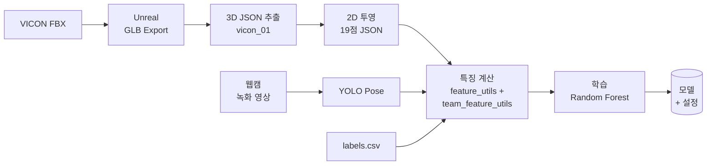
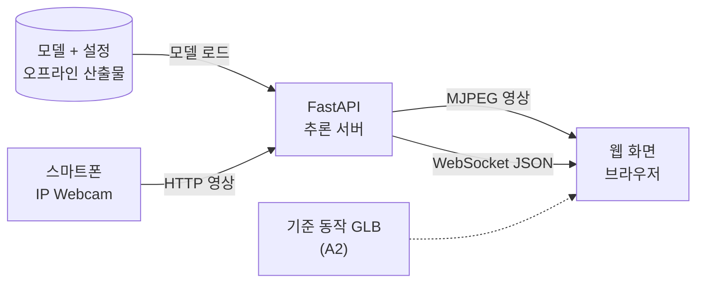
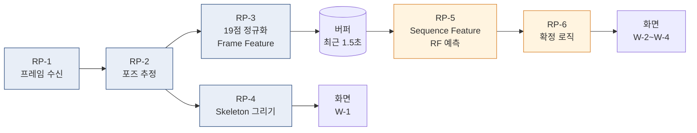

# 시스템 아키텍처

> 학습 파이프라인(오프라인)과 실시간 심판 수신호 인식 시스템(IP Webcam → FastAPI 추론 서버 → 웹 화면)의 구성 요소, 데이터 흐름, API, 실행 환경을 정의함.

## 목차

1. [문서 개요](#1-문서-개요)
2. [결정 대기 항목](#2-결정-대기-항목)
3. [전체 구성](#3-전체-구성)
4. [실시간 처리 흐름](#4-실시간-처리-흐름)
5. [웹 화면 구성](#5-웹-화면-구성)
6. [API 명세](#6-api-명세)
7. [신호 메타데이터](#7-신호-메타데이터)
8. [디렉터리 구조](#8-디렉터리-구조)
9. [실행 환경](#9-실행-환경)
10. [성능 목표](#10-성능-목표)
11. [오류 처리](#11-오류-처리)
12. [실시간 로그](#12-실시간-로그)
13. [보안과 데이터](#13-보안과-데이터)
14. [후속 작업](#14-후속-작업)
15. [변경 이력](#15-변경-이력)

---

## 1. 문서 개요

| 항목 | 내용 |
| --- | --- |
| 목적 | 시스템을 이루는 구성 요소와 연결 방식을 고정해 역할 분담·개발 기준으로 사용 |
| 범위 | 오프라인 학습 파이프라인, 실시간 추론 서버, 웹 화면, 서버–화면 간 API |
| 기준 | 교과 10 수업 1일차(IP Webcam), 7일차(실시간 Sliding Window), 3번 문서(FastAPI + Three.js) |
| 대상 독자 | 조원 전원 (개발 분담 시 구성 요소 단위로 담당 지정) |
| 다루지 않음 | 관절·투영 규칙(→ 01), 라벨 기준(→ 02), 촬영 조건(→ 03), 특징·모델·확정 규칙(→ 04) |

---

## 2. 결정 대기 항목

| ID | 항목 | 선택지 | 임시 기본값 | 상태 | 담당 | 기한 |
| --- | --- | --- | --- | --- | --- | --- |
| A1 | Skeleton 표시 방식 | ① 서버에서 그린 영상 전송 (MJPEG) ② 브라우저 canvas에 그리기 | ① | ⚪ 미정 | TBD | TBD |
| A2 | 기준 동작 3D 재생 (Three.js) | ① 1차 기능에 포함 ② 2차 기능 (여유 시) | ② | ⚪ 미정 | TBD | TBD |
| A3 | 추론 서버 실행 위치 | ① 학생 PC (Windows + WSL2) ② 원내 GPU 서버 | ① | ⚪ 미정 | TBD | TBD |
| A4 | 처리 FPS 목표 | ① 15 FPS ② 30 FPS | ① | ⚪ 미정 | TBD | TBD |
| A5 | 웹 화면 구현 방식 | ① HTML + JavaScript 단일 페이지 (FastAPI 정적 파일) ② 프론트엔드 프레임워크 | ① | ⚪ 미정 | TBD | TBD |

- 다른 문서 결정과 연결: 포즈 모델(`01` D1 = ① YOLO만, 결정됨), 대표 인물 선택(`01` D6 = ② 가장 큰 BBox, 결정됨), 확정 규칙(`04` F5)
- 결정 전에는 **임시 기본값**으로 개발함.

> [!warning] 결정 대기 — A1 Skeleton 표시 방식
> 임시 기본값: ① 서버에서 Skeleton을 그린 영상을 MJPEG로 전송
> - ① 장점: 구현 단순 (수업 1·2일차 `result.plot()` 방식 재사용), 화면은 `` 태그 하나
> - ① 단점: 영상 인코딩 부하, 화면에서 관절 표시 방식 변경 불가
> - ② 장점: 서버는 좌표만 전송, 화면에서 Confidence별 색 표시 등 자유로움
> - ② 단점: 원본 영상과 좌표의 시간 맞추기 필요, 프론트 코드 증가

> [!warning] 결정 대기 — A2 기준 동작 3D 재생
> 임시 기본값: ② 2차 기능
> - 기능: 신호가 확정되면 해당 신호의 VICON 기준 동작을 3D 캐릭터로 재생 (발표 효과 큼)
> - 필요 작업: 신호 15개 GLB Export (Unreal 리타게팅, 2번 문서) + Three.js 재생 화면 (3번 문서 코드 재사용)
> - 1차 목표인 신호 인식이 동작한 뒤 추가할 것을 권장

> [!warning] 결정 대기 — A3 실행 위치 / A4 처리 FPS
> 임시 기본값: A3 ① 학생 PC (WSL2), A4 ① 15 FPS
> - 비솔 데이터 외부 반출 제한 가능성 → 외부 클라우드 사용 안 함 (13장)
> - 15 FPS로도 윈도우 1.5초에 약 22프레임 확보, 리샘플 30시점에 충분
> - 확인된 PC: 조원 PC 1대 RTX 3060 + WSL (`의사결정·작업 기록` 2026-11-13). 이 PC에서 처리 FPS 측정 후 30 FPS 가능하면 상향 (PF-01)

---

## 3. 전체 구성

### 3.1 오프라인 · 학습 파이프라인



### 3.2 실시간 시스템



### 3.3 구성 요소

| 구성 요소 | 역할 | 기술 | 관련 문서 | 담당 |
| --- | --- | --- | --- | --- |
| C-01 VICON 변환 | FBX → GLB → 3D JSON | Unreal, Python(NumPy) — `vicon_00`·`vicon_01` (`01` D4 = ③) | 2번 문서, 01 6.3·7.4 | 1조 (완료: 50/50 PASS) |
| C-02 투영기 | 3D JSON → 19점 2D JSON (각도·반전) | Python, NumPy | 01 6.4장 | TBD |
| C-03 웹캠 포즈 추출 | 녹화 영상 → 17점 (+17·18 = 0, `01` M-12) | Ultralytics YOLO, OpenCV | 01, 03 | TBD |
| C-04 특징 계산 | 19점 → Frame/Sequence Feature | Python, NumPy | 04 5~7장 | TBD |
| C-05 학습 | 모델 학습·실험 기록 | scikit-learn, joblib | 04 8·10장 | TBD |
| C-06 추론 서버 | 실시간 영상 → 판정 | FastAPI, OpenCV, Ultralytics | 05 4·6장 | TBD |
| C-07 웹 화면 | 영상·판정 결과 표시 | HTML, JavaScript (Three.js: A2) | 05 5장 | TBD |

- C-04 특징 계산 코드는 학습(C-05)과 추론(C-06)이 **같은 모듈을 import** (`04` 문서 FR-02): 수업 `src/feature_utils.py`(수정 금지) + 조 `src/team_feature_utils.py`

---

## 4. 실시간 처리 흐름



- 파란 상자: 프레임마다 실행 (15 FPS) / 주황 상자: 0.25초(Stride)마다 실행

| 단계 | 처리 | 주기 | 시간 예산 (A4 = 15 FPS 기준) |
| --- | --- | --- | --- |
| RP-1 | 프레임 수신 (별도 스레드, 최신 프레임만 유지) | 카메라 FPS | — |
| RP-2 | 포즈 추정 | 프레임마다 | ≤ 40 ms |
| RP-3 | 대표 인물 선택 → 19점 변환·정규화 → Frame Feature | 프레임마다 | ≤ 5 ms |
| RP-4 | Skeleton 그리기 → MJPEG 인코딩 | 프레임마다 | ≤ 10 ms |
| RP-5 | Sequence Feature → Random Forest 예측 | 0.25초마다 | ≤ 20 ms |
| RP-6 | 확정 로직 → WebSocket 전송 | 0.25초마다 | ≤ 2 ms |
| 합계 | 프레임당 | | ≤ 66 ms (= 15 FPS) |

- RP-1 입력 방향 (`03` 문서 W7, 2026-11-17 결정): 학습 영상은 **세로 1080×1920 · 30 FPS**. 실시간 · 업로드 모두 frame 높이 > 너비인지 확인하고, 가로로 들어오면 `cv2.rotate`로 세로로 돌린 뒤 RP-2로 보냄 (IP Webcam은 "영상 보는 방식 → 세로 보기"). 해상도가 다르면 비율 유지로 1080×1920에 맞춤 — 학습과 같은 조건이어야 정규화 · Feature 분포가 같음
- RP-1을 별도 스레드로 두는 이유: IP Webcam은 영상이 버퍼에 쌓여 지연이 커짐 → 항상 최신 프레임만 처리 (수업 1일차 `CAP_PROP_BUFFERSIZE` 설정과 같은 목적)
- 시간 예산은 목표값. 실제 학생 PC에서 측정 후 10장에 기록

---

## 5. 웹 화면 구성

화면 배치 (가로 2단):

| 화면 왼쪽 | 화면 오른쪽 |
| --- | --- |
| **상단 바**: 제목 · 카메라 연결 상태 · 처리 FPS | (상단 바 계속) |
| **W-1 실시간 영상**<br/>카메라 영상 + Skeleton | **W-2 판정 결과**<br/>예: 시계 정지 → 블로킹 · 파울 · 확정<br/><br/>**W-3 예측 상위 3개**<br/>A01 0.82 / A15 0.09 / N00 0.05 (막대그래프) |
| **W-4 판정 기록**<br/>16:02:11 블로킹<br/>16:02:03 트래블링 | **W-5 기준 동작 3D** (A2)<br/>Three.js 캐릭터 재생 |

영역별 내용:

| 영역 | 내용 | 데이터 출처 |
| --- | --- | --- |
| W-1 실시간 영상 | 카메라 영상 + Skeleton | `GET /video_feed` |
| W-2 판정 결과 | 확정 신호 이름, 분류(파울·바이올레이션 등), 상태(판정 중·확정·확인 필요) | WebSocket `state`, `confirmed` |
| W-3 예측 상위 3개 | 현재 윈도우의 클래스별 확률 | WebSocket `top3` |
| W-4 판정 기록 | 확정된 신호의 시간순 목록 | WebSocket `confirmed` 누적 |
| W-5 기준 동작 3D | 확정 신호의 VICON 기준 동작 재생 (A2) | `GET /assets/glb/{label}.glb` |
| 상단 상태 표시 | 카메라 연결 여부, 처리 FPS | `GET /api/health` |

---

## 6. API 명세

### 6.1 HTTP

| ID | 메서드 | 경로 | 설명 | 응답 |
| --- | --- | --- | --- | --- |
| API-01 | GET | `/` | 웹 화면 | `index.html` |
| API-02 | GET | `/video_feed` | Skeleton이 그려진 실시간 영상 (A1 = ①) | `multipart/x-mixed-replace` (MJPEG) |
| API-03 | GET | `/api/health` | 서버 상태 | JSON (아래) |
| API-04 | GET | `/api/signals` | 신호 메타데이터 목록 | `signals.json` 내용 (7장) |
| API-05 | POST | `/api/camera` | IP Webcam 주소 변경 | `{"ok": true}` |
| API-06 | GET | `/assets/glb/{label}.glb` | 기준 동작 GLB (A2) | GLB 파일 |
| API-07 | POST | `/api/predict_video` | **업로드 테스트용 (계획)** — 학습 후 영상 1~2개를 올려 전체 흐름 확인. MP4 세로 1080×1920 · 30 FPS 기준 (RP-1과 같은 방향 확인) | JSON: `clip_label` · `confidence` · 0.25초 간격 `timeline` [{t, label, prob}] |

`GET /api/health` 응답:

```json
{
  "status": "ok",
  "camera_connected": true,
  "camera_url": "http://192.168.0.10:8080/video",
  "model_version": "rf_v3",
  "fps": 15.2,
  "uptime_sec": 412
}
```

### 6.2 WebSocket `/ws/result`

- 서버 → 화면, 0.25초(Stride)마다 1건 전송

| 필드 | 타입 | 설명 |
| --- | --- | --- |
| ts | float | 서버 시각 (Unix 초) |
| person_detected | bool | 사람 검출 여부 |
| state | str | `idle`(사람 없음), `judging`(판정 중), `confirmed`(확정), `uncertain`(확인 필요) |
| top3 | object[] | `{label, prob}` × 3, 확률 내림차순 |
| confirmed | object \| null | 이번에 새로 확정된 판정. 없으면 `null` |
| confirmed.labels | str[] | 묶인 신호 순서 (예: `["C01", "A01"]`, `04` RT-07) |
| confirmed.display | str | 화면 표시 문구 |
| fps | float | 최근 처리 FPS |

```json
{
  "ts": 1763017331.25,
  "person_detected": true,
  "state": "confirmed",
  "top3": [
    {"label": "A01", "prob": 0.82},
    {"label": "A15", "prob": 0.09},
    {"label": "N00", "prob": 0.05}
  ],
  "confirmed": {"labels": ["C01", "A01"], "display": "시계 정지 → 블로킹"},
  "fps": 15.2
}
```

---

## 7. 신호 메타데이터

- 파일: `configs/signals.json`. 화면 표시 문구·분류를 코드와 분리해 관리

| 필드 | 타입 | 설명 |
| --- | --- | --- |
| label | str | `A01`~`A15`, `C01`, `N00` (`02` 문서 4장) |
| name_ko | str | 국문명 |
| name_en | str | 영문명 (FIBA) |
| category | str | `파울`, `특수 파울`, `바이올레이션`, `파울 보고`, `경기 운영`, `시계 정지`, `없음` |
| result_text | str | 판정 결과 안내 (조 '상황 그림' 자료의 결과 문구) |
| glb | str \| null | 기준 동작 GLB 파일명 (A2) |

```json
[
  {
    "label": "A01",
    "name_ko": "블로킹 / 비합법적인 스크린",
    "name_en": "Blocking / Illegal screen",
    "category": "파울",
    "result_text": "개인 파울 → 상대 팀 스로인",
    "glb": "A01_blocking.glb"
  },
  {
    "label": "A06",
    "name_ko": "트래블링",
    "name_en": "Travelling",
    "category": "바이올레이션",
    "result_text": "상대 팀이 가까운 곳에서 스로인 (자유투 없음)",
    "glb": "A06_travelling.glb"
  }
]
```

---

## 8. 디렉터리 구조

- 별도 저장소를 만들지 않고 **조 레포 `subject10_pose_action/`(수업 폴더 구조)에 추가**함. 수업 파일은 고치지 않고 새 파일만 추가 (레포 운영 원칙)
- 표시: 표시 없음 = 레포에 있음 / `(예정)` = 아직 없음

```text
subject10_pose_action/
├── configs/
│   ├── project.json                  # 수업 1일차 공통 설정 (모델명, Confidence 등)
│   ├── feature_config.json           # (예정) 04 문서 11장
│   └── signals.json                  # (예정) 7장 신호 메타데이터
├── src/
│   ├── common.py · pose_utils.py     # 수업 1·2일차
│   ├── feature_utils.py              # 수업 3일차 38-D (수정 금지)
│   ├── vicon_utils.py                # 조: GLB → 월드 좌표, 몸 방향
│   ├── referee_utils.py              # 조: 스모크 테스트 전용 (본 파이프라인 아님)
│   ├── team_keypoints.py             # (예정) 19점 변환·투영·반전 (01)
│   ├── team_feature_utils.py         # (예정) 추가 특징·품질 검사·Sequence Feature (04)
│   └── team_confirm.py               # (예정) 실시간 확정 로직 (04 9장)
├── scripts/
│   ├── 00~18_*.py                    # 수업 1~3일차 실습
│   ├── referee_00~04_*.py            # 스모크 테스트 (기록용 고정)
│   ├── vicon_00_make_take_log.py     # C-01 Take 대응표
│   ├── vicon_01_extract_3d_json.py   # C-01 GLB → 3D JSON
│   ├── vicon_02_project_2d.py        # (예정) C-02 3D → 2D 투영
│   ├── team_extract_webcam.py        # (예정) C-03 웹캠 포즈 추출
│   ├── team_build_windows.py         # (예정) 학습 샘플 생성
│   ├── team_train.py                 # (예정) C-05 학습
│   └── team_validate.py              # (예정) 01·02 문서 V-규칙 검사
├── server/                           # (예정) C-06 FastAPI 앱 (app.py · camera.py · pipeline.py)
├── web/                              # (예정) C-07 화면 (index.html · app.js · assets/glb/)
├── docs/referee/                     # 설계 문서 01~05
├── reports/
│   ├── day01/ day02/ day03/          # 수업
│   ├── referee/smoke/                # 스모크 테스트 결과
│   └── vicon/extract_3d_report.csv   # V-01~V-03 결과
├── data/                             # Git 제외 (raw/vicon, take_log.csv, vicon_3d/ …)
├── artifacts/models/                 # (예정) 모델 파일, Git 제외
├── pyproject.toml · uv.lock
└── README.md
```

- 예정 파일 이름은 4일차 이후 수업 코드 이름(예: 4일차 `scripts/team_batch_build_sequences.py`)이 나오면 그 이름에 맞춤

---

## 9. 실행 환경

| 항목 | 기준 | 비고 |
| --- | --- | --- |
| OS | Windows + WSL2 Ubuntu | 수업 1일차 환경 |
| Python | 3.12, `uv sync --python 3.12` (`pyproject.toml`·`uv.lock` 기준) | 조 레포·`팀원 환경설정 가이드` |
| 주요 라이브러리 | ultralytics, opencv-python, numpy, pandas, scikit-learn, joblib, fastapi, uvicorn | MediaPipe는 1단계 미사용 (`01` D1 = ①). 2단계 확장 시 추가 |
| GPU | NVIDIA GPU 있으면 CUDA 사용, 없으면 CPU (`device: auto`) | 수업 1일차 `resolve_device()` |
| 카메라 | 스마트폰 IP Webcam, PC와 같은 Wi-Fi | 기관 Wi-Fi가 기기 간 통신을 막으면 핫스팟 사용 |
| 브라우저 | Windows Chrome에서 `http://localhost:8000` 접속 | 3번 문서 방식 |

실행 순서:

```bash
cd ~/ai_vision/subject10_pose_action
uv run uvicorn server.app:app --host 0.0.0.0 --port 8000
# 브라우저: http://localhost:8000
# 카메라 주소는 configs/project.json 또는 화면에서 변경 (API-05)
```

---

## 10. 성능 목표

| ID | 지표 | 목표 | 측정 방법 | 측정값 |
| --- | --- | --- | --- | --- |
| PF-01 | 처리 FPS | ≥ 15 (A4) | `/api/health` fps 1분 평균 | — |
| PF-02 | 영상 지연 | ≤ 0.5초 | 화면에 스톱워치 비추고 실제 시각과 비교 | — |
| PF-03 | 판정 지연 (신호 시작 → 확정 표시) | ≤ 2.5초 | 시나리오 클립(`03` W3) 라벨 시작 시각과 확정 시각 비교 | — |
| PF-04 | 연속 실행 안정성 | 30분 이상 오류 없이 동작 | 실시간 로그 확인 | — |

- PF-03 근거: 윈도우가 신호로 채워지는 시간(약 1초) + 확정 규칙 K × Stride(4 × 0.25 = 1초) + 처리 시간

---

## 11. 오류 처리

| ID | 상황 | 처리 | 화면 표시 |
| --- | --- | --- | --- |
| ER-01 | 카메라 연결 끊김 | 2초마다 재연결 시도, 버퍼 초기화 | '카메라 연결 끊김' (빨간 점) |
| ER-02 | 사람 미검출 0.5초 이상 | 버퍼 초기화 (`04` RT-03) | state = `idle` |
| ER-03 | 모델 파일 로드 실패 | 서버 시작 중단, 오류 로그 | `/api/health` status = `error` |
| ER-04 | 설정 파일 버전과 모델 버전 불일치 | 서버 시작 중단 (`04` 11장) | 오류 로그 |
| ER-05 | WebSocket 연결 끊김 | 화면에서 2초마다 재연결 | '서버 연결 중' |
| ER-06 | 처리 FPS가 10 미만 30초 이상 | 경고 로그 | FPS 숫자 주황색 |
| ER-07 | 입력이 가로 영상 · FPS가 30과 다름 (RP-1 · API-07) | 가로는 세로로 회전, FPS는 시간 기준으로 맞춤. 회전 · 변환한 사실을 응답 `warnings`에 남김 | '영상 방향 · FPS 변환됨' |

---

## 12. 실시간 로그

- 파일: `reports/realtime_log_{날짜}.csv`. 실패 원인 분석(수업 10일차)과 PF 측정에 사용
- Stride마다 1행 기록

| 컬럼 | 설명 |
| --- | --- |
| ts | 서버 시각 |
| fps | 최근 처리 FPS |
| person_detected | 사람 검출 여부 |
| top1_label, top1_prob | 최고 확률 클래스와 확률 |
| state | `idle` / `judging` / `confirmed` / `uncertain` |
| confirmed_labels | 확정 시 신호 순서 (예: `C01;A01`, 세미콜론 구분) |
| model_version | 사용 모델 버전 |

- 영상 자체는 기본 저장 안 함. 실패 분석이 필요할 때만 녹화 옵션 사용 (13장)

---

## 13. 보안과 데이터

- 추론 서버·학습은 **로컬(학생 PC 또는 원내 서버)에서만** 실행. 외부 클라우드(AWS, Colab) 사용 안 함 — 비솔 데이터 외부 반출 허용 여부 확인 전까지 (8/12 미팅 노트)
- 외부 GitHub에는 코드·문서만 올리고 `data/`, `artifacts/`, 영상·모델 파일은 제외 (수업 1일차 `.gitignore`)
- 서버는 같은 네트워크 안에서만 접속. 공용 Wi-Fi에서 시연 시 `--host 127.0.0.1`로 PC 내부 접속만 허용 검토
- 실시간 영상은 저장하지 않는 것이 기본. 녹화 시 `03` 문서 11장 개인정보 기준 따름

---

## 14. 후속 작업

| # | 작업 | 구성 요소 | 담당 | 완료 조건 |
| --- | --- | --- | --- | --- |
| 1 | A1~A5 결정 | — | 1조 전원 | 2장 상태 '결정됨' |
| 2 | ~~저장소 디렉터리 생성~~ → 조 레포에 `(예정)` 파일 추가 (8장) | 전체 | TBD | `server/`·`web/` 빈 구조 + 실행 확인 |
| 3 | 수신 스레드 + 포즈 추정 + MJPEG (RP-1·2·4) | C-06 | TBD | 화면에 Skeleton 영상 표시 |
| 4 | 처리 FPS·영상 지연 측정 | C-06 | TBD | PF-01·PF-02 측정값 기록 |
| 5 | 모델 연결 + 확정 로직 + WebSocket (RP-5·6) | C-06 | TBD | 화면에 판정 결과 표시 |
| 6 | 웹 화면 W-1~W-4 | C-07 | TBD | 5장 화면 구성 완료 |
| 7 | `signals.json` 작성 (15개 신호) | C-07 | TBD | 상황 그림 자료의 결과 문구 반영 |
| 8 | 기준 동작 3D 재생 (A2 = ① 일 때) | C-01, C-07 | TBD | 확정 시 GLB 재생 |

---

## 15. 변경 이력

| 버전 | 날짜 | 작성자 | 변경 내용 |
| --- | --- | --- | --- |
| 0.1 | 2026-11-13 | 하민 | 초안 작성. 전체 구성·실시간 처리 흐름 다이어그램, 웹 화면, API, 신호 메타데이터, 디렉터리 구조, 성능 목표, 오류 처리. 결정 대기 A1~A5 |
| 0.2 | 2026-11-16 | 하민 | 조 레포 현황 반영: 8장 디렉터리를 별도 저장소 → 조 레포(수업 폴더 구조)에 추가하는 방식으로 변경, `features.py` → 수업 `feature_utils.py` + 조 `team_feature_utils.py`. C-01을 D4 결정(Python GLB 직접, 완료)으로, C-03에 M-12 반영. 9장 Python 3.12·`uv run`·레포 경로. D1·D6 결정 반영 |
| 2.0 | 2026-11-16 | 하민 | **2차 배포 — 문서 세트 버전 통일** (01~05 모두 2.0). 직전 개정 v0.2. 이후 개정은 2.1, 2.2 …, 다음 배포 때 3.0 |
| 2.1 | 2026-11-18 | 용훈 | `03` W7 세로 1080×1920 반영: RP-1 입력 방향 확인 · 회전 규칙, API-07 업로드 테스트(계획), ER-07 가로 · FPS 다른 입력 처리 |
